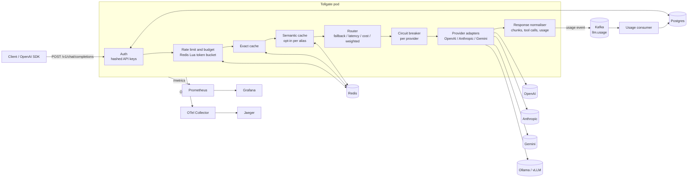

# Architecture

Tollgate is a stateless HTTP service. All durable or shared state lives in Redis (cache, rate limits), Postgres (keys, usage) and Kafka (usage events in flight), so any number of replicas can run behind a load balancer.

## Request lifecycle

Every chat request goes through the same steps, in this order. Each step can end the request early.

| # | Step | Failure |
|---|---|---|
| 1 | **Authenticate.** `Authorization: Bearer <key>`; the key is hashed with SHA-256 and looked up. Lookups are cached in-process for 15 s. | `401` |
| 2 | **Validate** the body against the OpenAI chat schema. Only `n = 1` is supported. | `400` |
| 3 | **Resolve the model name** to an alias route, or to a direct `provider/model` target. Check the key's alias allow-list. | `404`, `403` |
| 4 | **Rate limit.** Requests per minute (token bucket), daily token quota, monthly spend cap. | `429` + `Retry-After` |
| 5 | **Redact PII** (optional) into a copy of the request that is the only thing providers and the semantic embedder ever see. | n/a |
| 6 | **Exact cache** lookup. The key is built from the *original* request, so redaction can never make two different prompts collide. | falls through on any Redis error |
| 7 | **Semantic cache** lookup, if the alias opted in. | falls through on any error |
| 8 | **Dispatch.** Order the alias chain by policy, then try targets with circuit breaking, retries and failover. | `502`, `503`, `504` |
| 9 | **Settle.** Normalise usage, compute cost, emit the usage event, update counters and metrics, populate caches. | absorbed and counted |

## Provider adapters

Each adapter translates between the OpenAI wire format and a provider's native format. This is where most of the bugs live.

| Concern | OpenAI / local | Anthropic | Gemini |
|---|---|---|---|
| System prompt | native | `system` field; `system` and `developer` messages are joined | `systemInstruction` |
| Tool calls | native | `tool_use` / `tool_result` blocks; consecutive tool results merged into one user turn | `functionCall` / `functionResponse`; function name resolved from the earlier call id |
| Tool call ids | native | native | generated (Gemini has none) |
| Streaming | SSE, forwarded | typed SSE events mapped to chunks; tool arguments arrive as `input_json_delta` fragments | SSE of full responses; function calls arrive whole |
| Usage | `usage` (forced with `include_usage`) | `input_tokens` + cache reads/writes, `output_tokens` | `promptTokenCount`, `candidatesTokenCount` + `thoughtsTokenCount` |
| Parameters | pass-through | `temperature` clamped to 1, `max_tokens` defaulted to 4096 | JSON schema pruned to the supported subset |
| Finish reason | native | `end_turn`, `max_tokens`, `tool_use`... mapped | `STOP`, `MAX_TOKENS`, `SAFETY`... mapped; tool calls force `tool_calls` |

Ollama and vLLM speak the OpenAI protocol, so they use the OpenAI adapter with a different `baseUrl`.

## Failure semantics

**What counts as a failure.** An error is classified by `ProviderError`:

| Condition | Retry same provider | Fail over | Counts against breaker |
|---|---|---|---|
| `429`, `5xx`, `408`, timeout, network error | yes | yes | yes |
| `401`, `403` (misconfigured key) | no | yes | yes |
| `400`, `404`, `422` (bad request) | no | no, returned to the caller | no |
| Client disconnect | no | no | no |

Retries use exponential backoff with jitter, honour `Retry-After` up to 2 s, and stop as soon as the breaker opens.

**Circuit breaker.** One per provider, counting results in one-second buckets over a rolling `windowMs`. It opens when the window holds at least `failureThreshold` failures *and* the failure ratio is at least `failureRatio` (default 0.5). The ratio matters in both directions: a provider failing half its requests is ejected even though successes are interleaved, while a healthy provider at high traffic with a 1% error rate is not. It stays open for `openMs`, then lets exactly one probe request through (half-open). A successful probe closes it; a failed probe reopens it. While open, the provider is skipped without a network call. If every provider in a chain is open the request fails immediately with `503`.

**Streaming.** A stream is only committed to the client after the first chunk arrives from a provider. Anything that fails before that point (connect error, timeout, `5xx`, empty stream) fails over like a normal request. After the first chunk the response is already on the wire, so a mid-stream failure is reported as an SSE `error` event followed by `[DONE]`, and the provider is marked unhealthy. Clients should treat a stream without a `finish_reason` as incomplete.

**Client disconnects.** The upstream request is aborted, the usage event is recorded with `status: aborted`, partial output is billed using an estimate, and the provider is not penalised.

**Redis failure.** Rate limiting is configurable: `rateLimit.failureMode: open` keeps serving (and counts `tollgate_store_errors_total`), `closed` returns `503`. Caches always fail open. Choose `closed` only if exceeding a spend cap is worse for you than an outage.

**Kafka failure.** The request path never waits on Kafka. Events are queued in memory (bounded at 10,000), flushed in batches, retried on failure, and the oldest are dropped on overflow with `tollgate_usage_events_dropped_total` incremented.

## Cost accounting

Cost is computed in the gateway from the provider's own `usage` numbers and a versioned price book (`config/prices.yaml`, one row per model per `effective_from` date). Cached prompt tokens are priced at the cached rate. When a provider returns no usage (some local servers), tokens are estimated at four characters each and the event is flagged `usage_estimated`. Unknown models are served at zero cost and counted in `tollgate_unpriced_requests_total` so a missing price is visible rather than silent.

Cache hits are recorded with `cost_usd = 0` and `saved_usd` equal to the original request's cost, which is what the savings figures are built from.

## Rate limits and budgets

- **Requests per minute** are exact: an atomic Lua token bucket in Redis, using Redis `TIME` so replicas never disagree about the clock.
- **Daily tokens and monthly spend** are soft limits. They are checked before a request and charged after it, so concurrent in-flight requests can overshoot a cap by their own cost. Reserving an estimate up front would make the cap stricter at the price of false rejections.

## Data model

Postgres holds `api_keys` (hashes only; the plaintext is shown once at creation), `usage_events` (idempotent on `event_id`, so Kafka redelivery is harmless) and `model_prices`. See `migrations/001_init.sql`.
